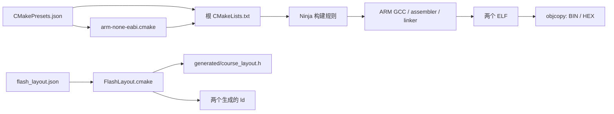

# 工程结构为什么这样划分

这里描述学习目录中的模块化对照工程。课程起步先阅读相邻的原 otatest 和 bootloader，见 project-comparison.md 和前四课。原工程目前仍分别管理工具链与分区，不会因为本目录的 JSON 变化自动同步。

## 构建路径



CMake Tools 是 VS Code 调用 CMake 的入口。它选择 Preset、展示目标、提供编译配置；Ninja 执行依赖图；GCC/汇编器/链接器产生代码；Cortex-Debug 通过 GDB 和 J-Link 操作设备。F5 的构建来自 preLaunchTask，而不是 CMake 本身负责下载。

## 目标关系

```text
bootloader ─┬─ board_support ─ stm32_spl ─ mcu_options
            ├─ image_format ─ mcu_options
            └─ ota_policy ─── mcu_options
app ────────── board_support ─ stm32_spl ─ mcu_options
```

每个可执行目标单独编译启动文件、system 文件和中断覆盖，再链接相同板级库。启动和 system 文件依赖镜像地址，不能让一个按 Boot 地址编译的 system.o 同时服务 App。

`mcu_options` 是 INTERFACE 库，传播 CPU/FPU、优化和生成头路径，不产生机器码。`stm32_spl` / `board_support` 是 STATIC 库。PRIVATE 只影响目标自己，PUBLIC 同时传播给使用者，INTERFACE 只影响使用者。

课程不把中断实现藏在板级静态库里：启动文件已经有弱默认中断符号，链接器未必会从归档中提取一个未引用的强覆盖实现。`interrupts.c` 直接加入每个可执行目标。

## 运行路径

```text
硬件复位读取 Boot 向量表的 MSP / Reset_Handler
  → Boot 启动汇编复制 .data、清零 .bss
  → SystemInit 配置时钟和 Boot VTOR
  → __libc_init_array → Boot main
  → 默认心跳，或在 JumpDebug 中检查 App 并交接
  → App Reset_Handler 重新初始化 App 的 .data/.bss
  → App SystemInit 设置 App VTOR
  → App main → App SysTick 和心跳
```

链接脚本描述地址与节的放置，启动代码负责实际复制和清零。CMake 把正确的脚本与正确的固件目标配对。三个角色缺一不可。

初始 MSP 可以等于 SRAM 尾地址；栈向低地址增长。`.data` 的 VMA 在 RAM，LMA 在 Flash；`.bss` 不需要在 BIN 中保存一份零。堆保留区会计入输出节，栈只通过边界检查预留，因此 memory usage 不等于运行时 RAM 峰值。

## 后续 OTA 路径

```text
App/Boot 通信入口 → 协议解析 → 镜像格式检查 → 下载槽
                                                 ↓
                                          持久化 DOWNLOADED
                                                 ↓ 复位
Boot 决策 → 校验候选镜像 → 生成独立旧版备份 → 提交 INSTALLING
  → 写内部 App → 校验读回 → TRIAL_READY
  → 写 TRIAL_RUNNING、开 IWDG、交接 App
  → App 健康确认 → NORMAL
  → 未确认就复位 → ROLLBACK → 旧版验证后启动
```

上面后半段是实验目标，不是当前 main 已完成的行为。`Ota_SelectAction()` 只回答下一步动作；判断候选和备份是否完整、执行动作并持久化结果，是后续安装器的责任。

## 扩展规则

新增源文件明确列入目标；新增 include 路径加到需要它的目标；新增 SPL 驱动同时检查源文件列表和 stm32f4xx_conf.h；链接脚本放固件目标；工具链只负责工具与目标平台；新硬件后端通过接口接入业务逻辑。

生成目录是结果，不是编辑入口。分区改 config/flash_layout.json；段布局改 linker/firmware.ld.in；MCU/时钟改变还需要重新移植板级代码。
